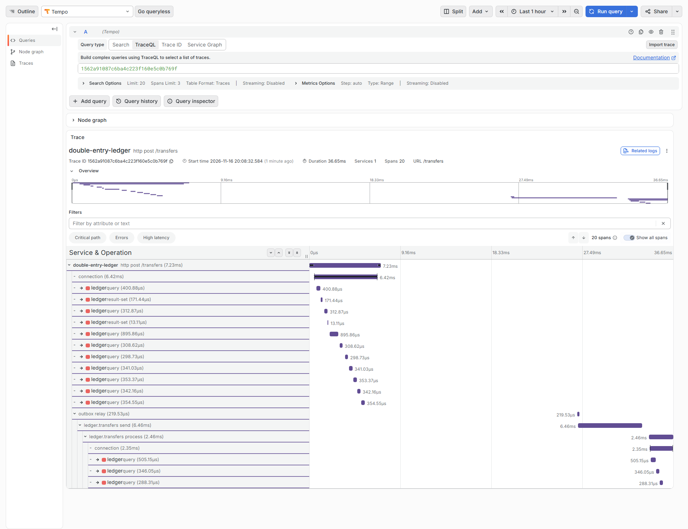

# double-entry-ledger

[](https://github.com/LucasSantana-Dev/double-entry-ledger/actions/workflows/ci.yml)

A money transfer service that never creates, loses or duplicates money, even with thousands of concurrent requests and clients retrying the same call. Every claim below comes from a test or a CI run in this repo, against real PostgreSQL, Kafka and Kubernetes in containers.

1. **Consistency under concurrency.** 0 invariant violations in 21,975 concurrent submissions, 10% of them sent twice with the same idempotency key. Seven invariants are checked straight in the database ([details](docs/results.md#what-the-tests-prove)).
2. **Throughput under contention.** Four concurrency strategies benchmarked. The default, a conditional `UPDATE`, creates 983 transfers/s with 90% of them hitting one account, against 228 for the serializable strategy, and never answers 503 ([benchmark](docs/results.md#benchmark-results)).
3. **Exactly once through failures.** Every transfer becomes one Kafka event and one set of statement lines, through a paused broker, a cut database connection, a consumer crash and duplicate deliveries ([events](docs/results.md#events)).
4. **Observability and deployment.** One trace follows a transfer from the HTTP request through the outbox to the consumer, ledger metrics feed a Grafana dashboard, and CI deploys the service to a kind cluster ([observability](docs/results.md#observability-and-deployment)).



Java 25 · Spring Boot 4.1 · Spring Data JPA · PostgreSQL 18 · Kafka · Flyway · Testcontainers · Toxiproxy · virtual threads · OpenTelemetry · Grafana · Docker · Kubernetes (kind)

Each design choice has an ADR in [docs/adr](docs/adr) with the options and the evidence; the [decision table](docs/results.md#design-decisions) lists them. A longer account of the four phases: [article draft](docs/writeup/2026-11-16-ledger-consistency-under-concurrency-and-failure.md).

## API

Amounts use the API Pix format, `"500.00"`. Every write needs an `Idempotency-Key` header. Errors are RFC 9457 problem details.

```bash
curl -s -X POST localhost:8080/accounts
curl -s -X POST localhost:8080/deposits -H 'Idempotency-Key: 7f9c...' -H 'Content-Type: application/json' \
  -d '{"accountId":"<id>","amount":"100.00"}'
curl -s -X POST localhost:8080/transfers -H 'Idempotency-Key: 1a2b...' -H 'Content-Type: application/json' \
  -d '{"fromAccountId":"<a>","toAccountId":"<b>","amount":"30.00"}'
curl -s localhost:8080/accounts/<id>
```

| Status | When |
|---|---|
| 201 | Created. A retry of a committed key returns the same body plus `Idempotent-Replayed: true` |
| 400 | Amount outside the Pix pattern, missing or invalid key, malformed body |
| 404 | Unknown account |
| 409 | Same key while the first request is still running: retry later |
| 422 | Insufficient funds, same key with a different payload, invalid transfer |
| 503 | Transfer kept conflicting with concurrent ones after 5 attempts; nothing was written, retry with the same key after `Retry-After` ([ADR 0010](docs/adr/0010-four-concurrency-strategies-and-bounded-retry.md)) |

## Running

`./mvnw` needs JDK 25 and Docker; `docker compose` needs only Docker. Outside tests, the application expects PostgreSQL and a Kafka broker (`SPRING_KAFKA_BOOTSTRAP_SERVERS`).

```bash
./mvnw verify                  # build and all tests
./mvnw spring-boot:test-run    # API on :8080 with throwaway PostgreSQL and Kafka containers
docker compose up -d --build   # API on :8080 plus Grafana on :3000, see docs/results.md
```

Bigger or different invariant runs:

```bash
./mvnw test -Dtest=ConcurrentTransfersInvariantTest -Dledger.invariant.operations=20000 -Dledger.invariant.seed=7
```

Load benchmark (Docker; one cell, short windows):

```bash
./mvnw -Pbenchmark verify -Dledger.bench.cells=strategy-pessimistic-hot30 -Dledger.bench.warmup=PT5S -Dledger.bench.measure=PT10S
```

## Roadmap

| Phase | Scope | Status |
|---|---|---|
| 1 | Accounts, deposits, transfers, idempotency, invariant test | done |
| 2 | Benchmark four locking strategies and virtual vs platform threads under load | done |
| 3 | Transactional outbox to Kafka, idempotent consumer, reconciliation, fault injection | done |
| 4 | Traces and metrics, deployment, results write-up | done |
