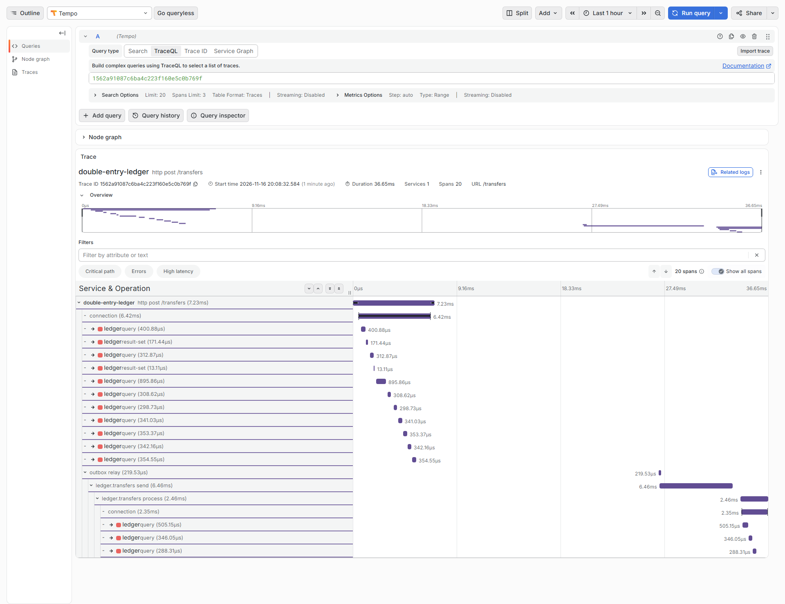
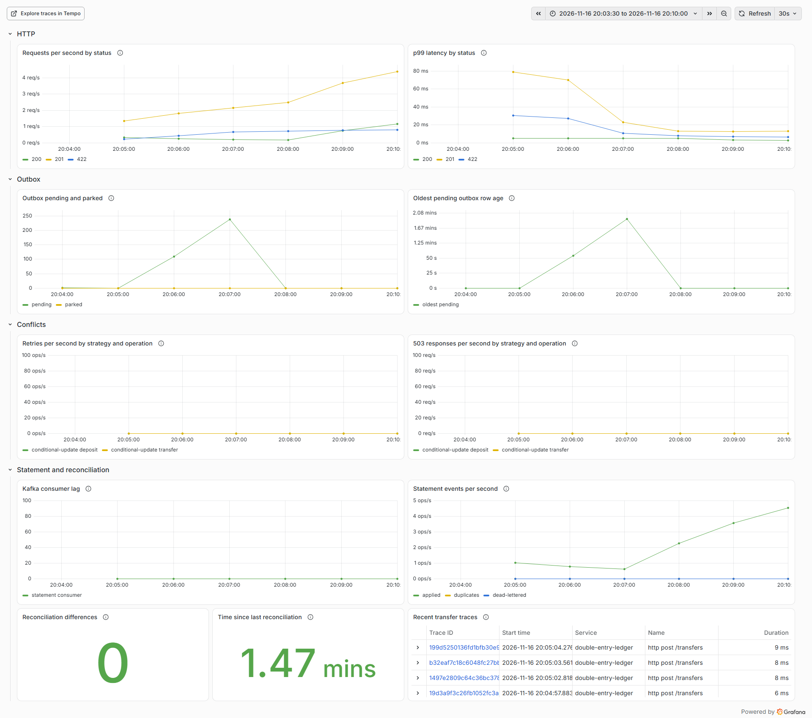

# Results and design

The detail behind the [README](../README.md): what each test asserts, the benchmark numbers, the event pipeline, observability, deployment and the decision log.

## What the tests prove

`ConcurrentTransfersInvariantTest` fires a seeded random workload at the service on virtual threads: transfers in both directions between the same accounts, 30% of them touching one hot account, amounts large enough that some must fail, and 10% of the requests sent twice at the same time with the same idempotency key. Then it checks, straight in the database:

1. The sum of all balances is zero (money in = money out of the settlement account).
2. No customer balance is negative.
3. Every balance equals the sum of its entries.
4. Every transfer is exactly two entries that cancel out.
5. No idempotency key produced more than one transfer, and every replay returned the original one.
6. Every transfer has its idempotency key stored.
7. Entries cannot be updated or deleted (the database rejects it).

It also fails on any unexpected exception, so a single deadlock or lock timeout breaks the build. On top of the database checks, it keeps a client-side model of every transfer reported as created and asserts that the stored transfers and every final balance match it exactly.

Runs on 2026-11-13 (JDK 25, PostgreSQL 18 in Docker, Windows 11 laptop):

| Seed | Submissions | Created | Replayed | Insufficient funds | 409 then retried | Violations |
|---|---|---|---|---|---|---|
| 20261113 (default) | 5,533 over 5,000 keys | 3,815 | 398 | 1,320 | 522 | 0 |
| 7 | 21,975 over 20,000 keys | 14,878 | 1,433 | 5,664 | 1,881 | 0 |

The seed fixes the workload, not the thread interleaving, so the counts move a little between runs of the same seed. The invariants must hold on every run. Timings are not reported here: this test is built to create contention, and phase 2 measures throughput.

## Benchmark results

One run on a GitHub-hosted runner (4 vCPU AMD EPYC 9V45, Java 25), 24 cells × 5 repetitions in shuffled order, 30 s warm-up and 60 s measured per cell, a fresh PostgreSQL 18 and a fresh application JVM per cell ([ADRs 0012 to 0015](adr/0012-benchmark-scenarios-and-metrics.md)). Values are medians over the 5 repetitions. Full tables with 95% bootstrap intervals: [results.md](benchmarks/2026-11-13/results.md); raw rows: [results.jsonl](benchmarks/2026-11-13/results.jsonl). After every cell the ledger checks passed (entries sum to zero, no negative customer balance, balances match entries).

**Strategies** (256 users, virtual threads; "hot" is the share of transfers that touch one shared account):

| strategy | created/s 0% / 30% / 90% hot | p99 ms (201) 0% / 30% / 90% | 503 per minute at 90% hot |
|---|---|---|---|
| conditional-update | 2,042 / 1,602 / 983 | 354 / 359 / 337 | 0 |
| pessimistic | 1,878 / 1,458 / 768 | 380 / 395 / 416 | 0 |
| optimistic | 1,813 / 1,043 / 292 | 391 / 676 / 745 | 16,158 |
| serializable | 1,557 / 808 / 228 | 446 / 830 / 917 | 13,186 |

- The two strategies that wait instead of aborting (conditional-update, pessimistic) degrade gracefully as contention grows and never return 503. Conditional-update is ahead of pessimistic in every cell: one `UPDATE ... WHERE balance >= x` per account instead of a `SELECT ... FOR UPDATE` plus an `UPDATE`.
- The two that abort (optimistic, serializable) collapse under a hot account: at 90% they create 3 to 4 times fewer transfers than conditional-update, and a large share of requests end in 503 after 5 attempts. Without a hot account optimistic is close to pessimistic, and serializable creates 17 to 24% fewer transfers than the waiting strategies.

**Virtual vs platform threads** (pessimistic strategy):

| users | hot | created/s platform / virtual | p99 ms platform / virtual | platform threads platform / virtual |
|---|---|---|---|---|
| 64 | 0% | 1,934 / 1,967 | 90 / 81 | 87 / 22 |
| 64 | 90% | 874 / 764 | 130 / 127 | 87 / 22 |
| 1,024 | 0% | 1,776 / 1,906 | 1,011 / 1,550 | 215 / 22 |
| 1,024 | 90% | 927 / 736 | 1,498 / 1,600 | 215 / 22 |

- Virtual threads do not raise throughput: 10 database connections cap the work in flight, so more request threads only add queueing. That was the hypothesis of ADR 0012 and the data agrees. Most cells are within about 10% with overlapping intervals; at 1,024 users and 90% hot, platform threads are ahead (927 against 736 created/s, intervals apart).
- Virtual threads keep the platform thread count flat (22 against 215 at 1,024 users). At 1,024 users they cost about 170 MB more heap (about 835 against 665 MB) and a longer p99 tail. A likely reason, not measured here: with virtual threads every request is admitted and its object graph lives while it waits for a connection, while Tomcat's 200-thread pool keeps the excess in the accept queue.

**Limits of these numbers.** One run on a shared cloud runner, with the load generator, the application and PostgreSQL on the same 4 vCPU VM; absolute numbers will differ elsewhere, the comparison between cells is the result. 5 repetitions make the bootstrap intervals coarse. PostgreSQL's CPU and the time spent waiting for a Hikari connection are not measured (ADR 0012); the application used about one core of four and the load generator under a third of a core, so the database and the 10-connection pool are the likely limit. Each cell starts from fresh tables with 1,000 accounts, so table and index bloat over hours is not covered.

## Events

Every committed transfer and deposit also becomes a `TransferCommitted` event on the Kafka topic `ledger.transfers`, and an account statement is built from those events. The event is a row in an `outbox_events` table written in the transfer's own transaction; a polling relay, kept to one active instance by a PostgreSQL advisory lock, sends it to Kafka and marks it published ([ADR 0016](adr/0016-outbox-polling-relay.md)). Delivery is at least once, so the statement consumer records each event id in the same transaction as its statement lines and skips ids it has seen ([ADR 0017](adr/0017-statement-projection-and-reconciliation.md)). A scheduled reconciliation compares the ledger with the statement and reports any difference.

Phase 3 invariants, asserted by tests:

1. Every committed transfer has exactly one outbox event, written in the same transaction; a rolled back transfer has none.
2. Every event is eventually published, including after the broker was down and after the database connection was cut between the send and the mark-published update.
3. The statement applies each event exactly once, even with duplicate deliveries and a consumer crash before the offset commit.
4. After every fault, reconciliation reports zero differences and every statement balance equals the ledger balance.
5. Per account, the statement follows commit order: lines are ordered by the ledger sequence the event carries, not by arrival. The invariant test checks this against the commit timestamps PostgreSQL records for the concurrent transactions.

`ConcurrentTransfersInvariantTest` checks all five on top of the seven above, for each of the four concurrency strategies: after the workload it waits for the relay to drain and the statement to catch up, then reconciles. `FaultInjectionTest` injects four faults against the real containers ([ADR 0019](adr/0019-fault-injection.md)):

| Fault | How it is injected |
|---|---|
| Broker down | Kafka container paused through the Docker API until the producer times out |
| Database connection cut between send and mark-published | The application reaches PostgreSQL only through Toxiproxy; a hook disables the proxy right after Kafka acknowledged the batch |
| Consumer crash after its commit, before the offset commit | A hook throws after the statement transaction committed, so the container redelivers |
| Duplicate delivery | Published rows set back to pending, so the relay sends every event again |

Phase 3 adds about 1 min 47 s to `./mvnw verify` locally (1 min 40 s to 3 min 27 s, 55 to 69 tests).

## Observability and deployment

### One trace per transfer, through the outbox

The relay sends an event on a scheduler thread, long after the request that wrote it has ended, and that is where traces usually break. Here the transfer transaction stores the current span's W3C `traceparent` in the outbox row (Flyway V5), and the relay opens its `outbox relay` span with that stored context as the parent. Kafka observation puts a `traceparent` header on the record, so the consumer span is a child of the send span. A row without a context (written while the request was not sampled, or before V5) gets a new root span and is published anyway ([ADR 0021](adr/0021-tracing-micrometer-otel-and-outbox-traceparent.md)). Tracing uses Spring Boot's OpenTelemetry starter with OTLP export and `datasource-micrometer` for JDBC spans, without a Java agent.



### Metrics, logs and the dashboard

None of the application's own meters ([ADR 0022](adr/0022-otel-lgtm-stack-metrics-and-logs.md)) is tagged with an account, transfer or key id.

| Meter | Tells |
|---|---|
| `ledger.outbox.pending`, `ledger.outbox.oldest.pending.age` | Events committed but not yet in Kafka, and how long the oldest has waited: the broker or the relay is stuck |
| `ledger.outbox.parked` | Events Kafka rejected for good; each one is a transfer missing from the statement until someone acts |
| `ledger.transfer.retries`, `ledger.transfer.unavailable` (tags `strategy`, `operation`) | Conflict retries and 503 answers per concurrency strategy, the phase 2 comparison on a running service |
| `ledger.reconciliation.differences`, `ledger.reconciliation.last.success` | Differences found by the last scheduled reconciliation, and when it last completed, so a stalled schedule shows |
| `ledger.statement.dead-lettered` | Events the statement could not apply, sent to `ledger.transfers.DLT` |
| `http.server.requests` with a percentile histogram | Requests and p99 per status, as phase 2 reported latency |

Logs are ECS JSON on the console with trace and span ids. The provisioned dashboard below was captured during a run of the smoke script in a loop plus random transfers (some for more than the balance, hence the 422s), with Kafka paused for 150 s (metrics are exported once a minute, so a shorter pause can fall between two samples): the pending outbox count and the oldest pending age climb while the broker is away and drop to zero when the relay drains.



### Running it locally

The compose file needs Docker with about 2 GB free for the observability container, on top of the application, PostgreSQL and Kafka.

```bash
docker compose up -d --build   # API on localhost:8080, Grafana on localhost:3000 (dashboard "Ledger")
SQL_CMD="docker compose exec -T postgres psql -U ledger -d ledger -tAc" bash deploy/smoke.sh
docker compose down -v
```

`grafana/otel-lgtm` (OpenTelemetry Collector, Prometheus, Tempo, Loki and Grafana in one image) is a demo backend intended for development and testing; production monitoring would need a different setup. Grafana opens without a login. Sampling is 1.0 in compose; the application default is 0.1.

### Kubernetes

The repo has a multi-stage `Dockerfile` (JDK 25 build, JRE 25 runtime, non-root) and Kustomize manifests: `deploy/k8s/base` with the application, PostgreSQL 18 and single-node KRaft Kafka StatefulSets, the topic setup, a ConfigMap and a Secret; `deploy/k8s/overlays/kind` for CI. Liveness and readiness come from the Actuator health groups. The [Deploy to kind](../.github/workflows/deploy-kind.yml) workflow builds the image, creates a kind cluster, applies the overlay, waits for the rollouts and runs `deploy/smoke.sh`: two accounts, a deposit, a transfer, the balances over HTTP, then the transfer's two statement lines in the database ([ADR 0024](adr/0024-kubernetes-on-kind-in-ci.md)). There is no public deployment. Kafka and PostgreSQL run as single nodes with no redundancy, which is enough for the demo.

### Phase 4 criteria

Each criterion is asserted by a test ([ADR 0023](adr/0023-observability-tests.md)):

| Criterion | Test |
|---|---|
| One committed transfer is one trace: HTTP server span, JDBC spans, relay span whose parent is the context stored in the outbox row, Kafka send, consumer span, in that parent order | `TracingTest`, spans captured in process from the real OpenTelemetry SDK |
| The Kafka record carries a `traceparent` header of that trace | `TracingTest` |
| A transfer committed while not sampled, or an outbox row without a `traceparent`, is still published and applied | `TracingTest` |
| While Kafka is paused, pending and oldest pending age rise; after it resumes, pending returns to 0 | `ObservabilityMetricsTest`, Kafka paused through the Docker API |
| Under optimistic and serializable with a hot account, retries are counted under the right `strategy` tag and `ledger.transfer.unavailable` equals the 503 responses | `ObservabilityMetricsTest` |
| After a clean scheduled reconciliation, `ledger.reconciliation.differences` is 0 | `ReconciliationTest` |
| A transfer's trace and a ledger metric reach a real backend over OTLP | `OtlpExportSmokeTest` with `LgtmStackContainer` |
| The kind deployment rolls out and the smoke test passes | `deploy-kind.yml` |
| The phase 1 and phase 3 invariants stay green for all four strategies, and the fault injection scenarios too | `ConcurrentTransfersInvariantTest`, `FaultInjectionTest` |

## Footprint and cost

There is no public deployment ([ADR 0026](adr/0026-no-public-deployment-cost-map-instead.md)). Phase 5 measured what the stack uses and cut it instead. `python tools/footprint/footprint.py --label <name>` starts the application, PostgreSQL and Kafka from `compose.yaml`, runs the smoke test and 10,000 concurrent transfers, and records peak memory, CPU, startup time and image size per container in `docs/footprint/`.

| | baseline | after phase 5 |
|---|---|---|
| peak memory, application / PostgreSQL / Kafka | 859 / 119 / 482 MiB | 465 / 91 / 428 MiB |
| memory limits | none | 768 / 256 / 576 MiB, 1,600 MiB in total |
| application startup (median of restarts) | 4.7 s | 2.9 s |
| application image on disk | 596 MB | 748 MB, 118 MB of it the AOT cache |

The memory came from SerialGC with a heap sized to the container limit, half the Kafka heap and a smaller PostgreSQL buffer pool ([ADR 0027](adr/0027-memory-target-2-gb.md)). The startup came from a JVM AOT cache, created by a training start of the application during the image build ([ADR 0028](adr/0028-jvm-aot-cache-for-startup.md)). With the application pinned to 2 cores and the same lean heap, conditional-update created 1,861, 1,384 and 699 transfers per second at 0%, 30% and 90% hot, 9 to 29% fewer than with 4 cores in phase 2 ([run](benchmarks/2026-11-16/results.md), [ADR 0029](adr/0029-throughput-per-dollar.md)).

On a $12 a month 2 GB machine (Lightsail, or t4g.small without its $3.65 public IPv4), that is 150 to 155 created transfers per second per dollar a month without a hot account, roughly twice what the 4 GB machines give. The [cost map](costs/2026-11-16-cost-map.md) has the machines, prices and sources, and its limits: the 2 vCPU machine is simulated on a shared x86 runner where PostgreSQL had cores of its own, the candidates are burstable, and the prices are list prices.

## Breaking point

The phase 2 benchmark used a closed model: 256 users, each waiting for its answer before sending again, so the load can never exceed what the service absorbs. The breaking-point run uses an open model instead. Transfers arrive at a fixed rate whether or not earlier ones were answered, latency is measured from each request's scheduled send time so a stalled generator cannot hide queueing (coordinated omission), and the rate climbs in 2 minute steps until the SLO breaks ([ADR 0030](adr/0030-breaking-point-slo-open-model.md)). The SLO: p99 at most 500 ms over every scheduled request, and at most 1% errors (5xx, timeouts at 5 s, connection errors). Conditional-update only, transfers only, 0% and 90% hot ([ADR 0031](adr/0031-breaking-point-scope.md)), with a generator of its own whose stall test is part of the run ([ADR 0032](adr/0032-own-open-model-generator.md)). The ledger checks run after every step. GitHub-hosted 4 vCPU runner, 5 repetitions in shuffled order, a fresh PostgreSQL and application per repetition.

| | 0% hot | 90% hot |
|---|---|---|
| capacity (last step within the SLO, median of 5) | at least 1,500 req/s, climbing in 100 req/s steps (the ladder was too short to find the ceiling) | 600 req/s [550, 600] |
| p99 at that step | 35 ms | 320 ms |
| first step outside the SLO | none up to 1,500 | 600 req/s in 2 of 5, 650 req/s in 3 of 5 |
| what a step outside the SLO looks like | 74 to 182 created/s, 87 to 95% errors, heap at its 1 GB limit (runs that jumped to 1,500) | p99 from 1.1 s to the 5 s timeout, 0 to 91% errors |
| ledger checks after every step, including collapsed steps | all passed | all passed |

Runs: [published](benchmarks/2026-11-17-breaking-point/published/results.md) (AMD EPYC 9V45), [calibration](benchmarks/2026-11-17-breaking-point/calibration/results.md) (EPYC 9V74), [jump to 1,500](benchmarks/2026-11-17-breaking-point/jump-to-1500/results.md) (EPYC 7763).

**Two failure modes, neither fully explained yet.** At 0% hot, 1,500 req/s held in 5 of 5 repetitions on an EPYC 9V45 when the rate climbed to it in 100 req/s steps (p99 35 ms, a quarter of the CPU). Jumping to 1,500 req/s collapsed on two other CPU models: the EPYC 9V74 after a step from 1,000 (calibration, 1 repetition) and the EPYC 7763 after a jump from the 250 req/s warm-up (5 of 5), with 74 to 182 created transfers per second against 1,500 offered for the rest of the step. Climb and jump were never compared on the same CPU, so whether the path to the rate matters is a hypothesis, not a finding. A simpler reading also fits: with 9 usable database connections, 1,500 req/s leaves about 6 ms per transfer, the p99 was already rising (16, 22, 35 ms over the last three steps), and a slightly slower core may be enough to tip it. At 90% hot the failures are not monotonic: 3 repetitions broke at 650 req/s and then held 700 req/s (p99 4 ms) before breaking again at 750, so the service recovered by itself. Rate, elapsed time and database size grow together along the ladder, so these runs cannot tell a load limit from a periodic stall.

**Cause, as far as the data goes.** The 0% hot collapse is not a lack of CPU (the application used a quarter to a half of the 4 cores) and has the signature of congestion collapse with no admission control. Nothing has tested that yet: no run removed the mechanism and watched the collapse go away. Tomcat accepts up to 8,192 connections, each on its own virtual thread, and every one of them waits up to 30 s for one of 10 database connections while the client gives up at 5 s. Once a burst builds a queue, most of the pool's time goes to requests nobody is waiting for any more, the queue grows faster than it drains, and the heap fills with waiting requests. The application logs show thousands of `Connection is not available, request timed out after 30000ms (total=10, active=10, idle=0, waiting=~8180)`. The closed model of phase 2 never saw this because 256 users cap the queue at 256: it reached 2,042 created/s at 0% hot. The 90% hot failures have no diagnosed cause: their logs show almost no pool timeouts, and a checkpoint, an autovacuum or a GC pause would all fit. Bounding admission (a shorter pool wait, or a concurrency limit that answers 503 at once) should turn the collapse into fast 503s and more useful work under overload; it is not expected to raise the capacity. The next phase tests that on one runner, climb against jump, with the per-second pool queue and the PostgreSQL and GC logs recorded.

Limits. The generator, the application and PostgreSQL share the runner (generator CPU stayed at 3 to 19% of the machine). The outbox relay holds one of the 10 database connections while it waits for the Kafka broker, which is absent in the benchmark (phase 2 too). The send lag the run records covers the generator's scheduling, not time spent inside the JDK HTTP client before the request leaves. The database grows across the steps of a repetition rather than starting fresh at each step.

## Design decisions

Each decision has an ADR with the options, the evidence and the consequences.

| Decision | Choice | ADR |
|---|---|---|
| Runtime | Java 25 + Spring Boot 4.1 | [0001](adr/0001-java-25-and-spring-boot-4-1.md) |
| Build | Maven | [0002](adr/0002-maven.md) |
| Persistence | Spring Data JPA | [0003](adr/0003-spring-data-jpa.md) |
| Money | `long` cents, Pix decimal string at the API | [0004](adr/0004-money-as-long-cents.md) |
| Ledger model | Immutable entries + materialized balance | [0005](adr/0005-entries-plus-materialized-balance.md) |
| Idempotency | PostgreSQL, same transaction, 409 while in flight | [0006](adr/0006-idempotency-key-in-postgres.md) |
| Concurrency | `SELECT ... FOR UPDATE`, locks taken in id order | [0007](adr/0007-pessimistic-locking-ordered-by-id.md) |
| Default concurrency strategy | Conditional `UPDATE ... WHERE balance >= x`, chosen from the phase 2 benchmark | [0020](adr/0020-default-strategy-conditional-update.md) |
| Money entering | Settlement account + deposits | [0008](adr/0008-settlement-account-and-deposits.md) |
| Property tests | Seeded randomized JUnit tests | [0009](adr/0009-seeded-randomized-tests-instead-of-jqwik.md) |
| Publishing events | Transactional outbox, polling relay, single relay by advisory lock | [0016](adr/0016-outbox-polling-relay.md) |
| Consuming events | Statement projection, dedup table in the same transaction, scheduled reconciliation | [0017](adr/0017-statement-projection-and-reconciliation.md) |
| Event format | JSON envelope with Jackson 3, amounts in cents | [0018](adr/0018-json-event-envelope.md) |
| Fault injection | Toxiproxy for PostgreSQL, Docker pause for Kafka, test hooks | [0019](adr/0019-fault-injection.md) |
| Tracing | Boot's OpenTelemetry starter, Kafka observation, JDBC spans, `traceparent` stored in the outbox row | [0021](adr/0021-tracing-micrometer-otel-and-outbox-traceparent.md) |
| Metrics, logs, local stack | `grafana/otel-lgtm` in compose over OTLP, custom outbox, conflict and reconciliation meters, ECS JSON logs | [0022](adr/0022-otel-lgtm-stack-metrics-and-logs.md) |
| Observability tests | Spans and meters asserted in process, one OTLP smoke test with `LgtmStackContainer` | [0023](adr/0023-observability-tests.md) |
| Deployment | Dockerfile, Kustomize with PostgreSQL and KRaft Kafka StatefulSets, kind in GitHub Actions, no public link | [0024](adr/0024-kubernetes-on-kind-in-ci.md) |
| Write-up | Final README and an article draft in the repo | [0025](adr/0025-results-write-up.md) |
| Public deployment | None; a cost map from the measured footprint instead | [0026](adr/0026-no-public-deployment-cost-map-instead.md) |
| Memory target | Application, PostgreSQL and Kafka in 2 GB | [0027](adr/0027-memory-target-2-gb.md) |
| Startup | JVM AOT cache from a training start in the image build | [0028](adr/0028-jvm-aot-cache-for-startup.md) |
| Throughput per dollar | Conditional-update cells on a simulated 2 vCPU machine | [0029](adr/0029-throughput-per-dollar.md) |
| Breaking point | SLO p99 500 ms and 1% errors, open model with arrival-rate steps, 4 vCPU runner | [0030](adr/0030-breaking-point-slo-open-model.md) |
| Breaking-point scope | Conditional-update, transfers only, 0% and 90% hot, 5 repetitions | [0031](adr/0031-breaking-point-scope.md) |
| Load generator | Own Java open-model generator instead of JMeter, wrk2 or k6 | [0032](adr/0032-own-open-model-generator.md) |

Market evidence behind the stack choices: [126 Brazilian Java job postings](market/2026-11-13-gupy-java-sample.md), reproducible with `tools/market/gupy_java_sample.py`. For phase 3: [100 postings, messaging and resilience keywords](market/2026-11-16-gupy-phase-3-keywords.md), `tools/market/gupy_phase3_keywords.py`. For phase 4: [100 postings, container, cloud, delivery and observability keywords](market/2026-11-16-gupy-phase-4-keywords.md), `tools/market/gupy_phase4_keywords.py` (Docker 50%, Kubernetes 40%, observability or monitoring in any sense 46%, Grafana and tracing 10% each).

